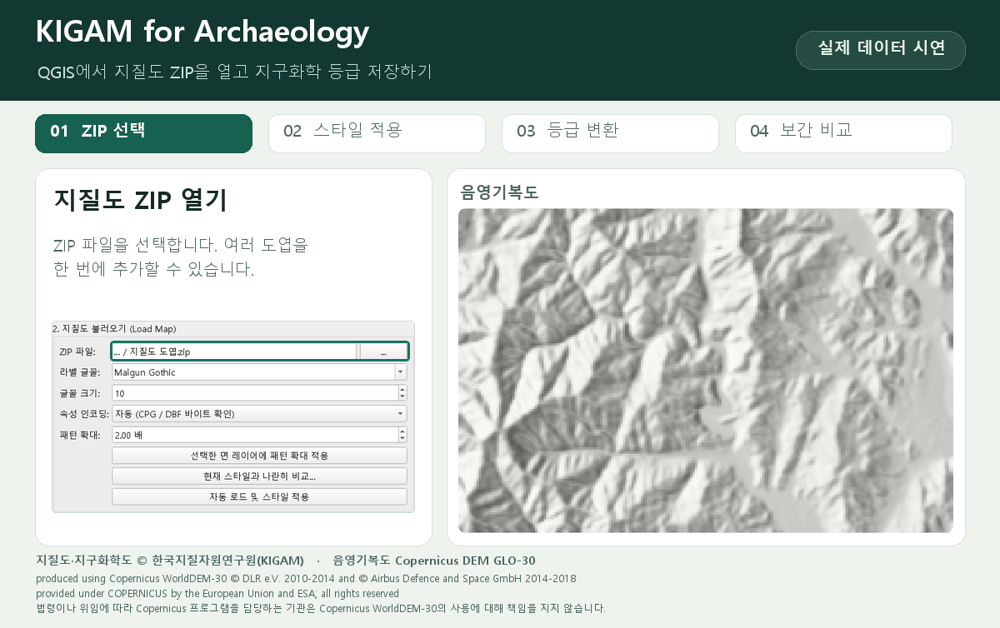

# KIGAM for Archaeology

고고학 공간분석용 QGIS 플러그인입니다. 한국지질자원연구원(KIGAM)의 지질도 ZIP을 불러와 심볼과 라벨을 적용하고, 다목적 지구화학도 WMS의 공식 범례 등급을 분석용 래스터로 저장합니다.

[QGIS 플러그인 저장소](https://plugins.qgis.org/plugins/KigamGeoDownloader/) · [GitHub 릴리스](https://github.com/lzpxilfe/KIGAM-for-Archaeology/releases) · [문제 제보](https://github.com/lzpxilfe/KIGAM-for-Archaeology/issues)

## QGIS 사용 예시



KIGAM의 실제 1:50,000 수치지질도 ZIP과 다목적 지구화학도 철(Fe₂O₃) WMS로 **ZIP 선택 → 스타일 적용 → 등급 저장 → 보간 전후 비교**를 시연했습니다. 지도는 일부만 보여주며 지명, 좌표, 도엽명과 파일 경로는 가렸습니다. [KIGAM 지오빅데이터 오픈플랫폼](https://data.kigam.re.kr/)

QGIS 레이어 목록에서 음영기복도를 맨 아래에 두고 지질도나 등급 래스터의 불투명도를 조절하면 지형을 함께 볼 수 있습니다.

배경 음영기복도는 공개 Copernicus DEM GLO-30에서 만들었습니다. [공개 DEM 데이터](https://registry.opendata.aws/copernicus-dem/) · [데이터 라이선스](https://documentation.dataspace.copernicus.eu/APIs/SentinelHub/Data/DEM/resources/license/License-COPDEM-30.pdf)

<sub>produced using Copernicus WorldDEM-30 © DLR e.V. 2010-2014 and © Airbus Defence and Space GmbH 2014-2018 provided under COPERNICUS by the European Union and ESA; all rights reserved.<br>
법령이나 위임에 따라 Copernicus 프로그램을 담당하는 기관은 Copernicus WorldDEM-30의 사용에 대해 책임을 지지 않습니다.</sub>

## 설치

QGIS 3.40 이상에서 **플러그인 → 플러그인 관리 및 설치**를 열고 **KIGAM for Archaeology**를 검색합니다. 설치 ZIP이 있다면 같은 창의 **ZIP에서 설치**에서 선택합니다.

아래 안내는 **0.1.6** 배포용 ZIP을 기준으로 합니다. 플러그인 하단의 **도움말 (?)** 또는 `F1`으로 한국어 사용 안내를 열 수 있습니다.

## 다목적 지구화학도 WMS 연결

플러그인에서 **WMS 연결 도움말 → WMS 주소 복사**를 누르면 접속 주소를 복사할 수 있습니다.

1. QGIS에서 **레이어 → 레이어 추가 → WMS/WMTS 레이어 추가**를 엽니다.
2. **새로 만들기**를 누르고 이름을 `KIGAM 다목적 지구화학도`로 정한 뒤, URL에 아래 주소를 붙여넣습니다.

   ```text
   https://data.kigam.re.kr/mgeo/geoserver/Geochemical_map/wms
   ```

3. **연결**을 누르면 서버가 제공하는 레이어 목록을 가져옵니다. 아래 표에서 원소를 골라 **레이어 하나**를 추가합니다. 스타일은 기본 `raster`, 이미지 형식은 **PNG**를 선택합니다. 작업할 원소가 여러 개라면 하나씩 추가합니다.
4. QGIS 지도에서 분석할 곳으로 이동합니다. 플러그인을 이미 열어 뒀다면 **레이어 목록 새로고침**을 누릅니다.

2026-11-20에 위 주소에서 인증키 없이 `GetCapabilities`와 아래 7개 레이어의 `GetMap` PNG를 확인했습니다. KIGAM의 인증키 방식 `/openapi/wms`는 별도 서비스입니다. 아래 ID는 다목적 지구화학도 지도 WMS에서 확인했습니다. [WMS 레이어 목록](https://data.kigam.re.kr/mgeo/geoserver/Geochemical_map/wms?service=WMS&request=GetCapabilities&version=1.3.0) · [KIGAM OpenAPI 안내](https://data.kigam.re.kr/guide/openapi?lang=ko) · [QGIS WMS/WMTS 가이드](https://docs.qgis.org/3.40/en/docs/user_manual/working_with_ogc/ogc_client_support.html#wms-wmts-client)

| 원소 | WMS 레이어 ID | 농도 단위 | 공식 범례 |
| --- | --- | --- | --- |
| 철 Fe₂O₃ | `L_geochemMP_FE2O3` | % | [Fe₂O₃](https://data.kigam.re.kr/mgeo/images/map/geochem/Fe2O3.png) |
| 납 Pb | `L_geochemMP_PB` | ppm | [Pb](https://data.kigam.re.kr/mgeo/images/map/geochem/Pb.png) |
| 구리 Cu | `L_geochemMP_CU` | ppm | [Cu](https://data.kigam.re.kr/mgeo/images/map/geochem/Cu.png) |
| 아연 Zn | `L_geochemMP_ZN` | ppm | [Zn](https://data.kigam.re.kr/mgeo/images/map/geochem/Zn.png) |
| 스트론튬 Sr | `L_geochemMP_SR` | ppm | [Sr](https://data.kigam.re.kr/mgeo/images/map/geochem/Sr.png) |
| 바륨 Ba | `L_geochemMP_BA` | ppm | [Ba](https://data.kigam.re.kr/mgeo/images/map/geochem/Ba.png) |
| 칼슘 CaO | `L_geochemMP_CAO` | % | [CaO](https://data.kigam.re.kr/mgeo/images/map/geochem/CaO.png) |

## 지구화학도 등급 변환

1. **플러그인 → KIGAM for Archaeology → KIGAM Tools**를 열고 **지구화학도 범례 등급 변환**에서 추가한 WMS 레이어를 선택합니다. 지원 레이어는 원소 프리셋을 자동으로 맞춥니다. 같은 팔레트의 8비트 RGB 파일을 사용할 때는 원소를 직접 선택합니다.
2. 분석 범위로 현재 지도 화면이나 대상지 벡터의 **경계 상자**를 선택하고 해상도를 입력합니다. 기본값은 30 m입니다.
3. **범례 등급 래스터와 대응표 저장**을 누릅니다. 예를 들어 `iron.tif`와 `iron.tif.categories.csv`를 생성합니다.

**래스터 셀에는 1~10의 등급 ID가 들어갑니다.** 철 지도에서 `10`은 범례의 12–51% 구간을 뜻합니다. CSV에는 등급별 백분위, 농도 구간, 단위, WMS 색상이 기록됩니다. 첫 구간의 하한과 경계값의 포함 방향은 미확인이며, 첫 구간의 하한은 CSV에 빈칸으로 남깁니다. 해상도 설정은 출력 격자의 셀 크기를 정합니다. [철 공식 범례](https://data.kigam.re.kr/mgeo/images/map/geochem/Fe2O3.png)

분류에는 실제 WMS PNG에서 확인한 RGB를 사용합니다. 회색 무자료색, 흰 배경, 마스크·알파로 제외된 셀, 범례 밖 색은 NoData로 기록됩니다. 로그와 GeoTIFF에서 제외 사유별 셀 수를 볼 수 있습니다.

검은 선으로 지도가 갈라져 보이면 **검은 경계선 보간**을 켭니다. 양쪽에 유효한 등급이 있는 좁은 틈을 찾아 가까운 쪽의 원본 등급으로 채웁니다. 회색 무자료와 투명 배경으로 열린 경계는 NoData로 남습니다. 기본값은 꺼짐이며, 보간 방식과 채운 셀 수를 GeoTIFF에 기록합니다. 최대 틈 폭은 `plugin_config.json`의 `geochem_fill_nodata_distance`에서 픽셀 단위로 설정합니다. 기본값은 30픽셀입니다.

## 지질도 ZIP과 래스터 내보내기

- [KIGAM 지질도 검색](https://data.kigam.re.kr/search?subject=Geology)에서 받은 Shapefile ZIP을 **자동 로드 및 스타일 적용**으로 불러옵니다. 여러 ZIP을 한 번에 선택할 수 있습니다.
- ZIP의 QML에서 심볼과 라벨을 적용하고, 추출본 안의 이미지 경로를 연결합니다. QML 적용이 실패하면 `sym/`의 PNG를 속성값과 대조합니다. CPG 선언과 DBF 바이트로 인코딩을 확인하며, 필요한 경우 CP949, EUC-KR, UTF-8을 직접 지정할 수 있습니다.
- 면 패턴은 **현재 스타일과 나란히 비교**에서 축척별로 비교합니다. 기본 2배, 1배는 원래 크기입니다. 배율을 바꿔도 누적 확대되지 않습니다.
- **래스터 변환 및 내보내기**에서 같은 지오메트리 유형의 지질 레이어나 지구화학 등급 래스터 하나를 GeoTIFF 또는 ASCII Grid로 내보냅니다. 지질 분류 ID와 지구화학 등급은 정수 범주로 보존합니다.
- MaxEnt에 함께 넣을 레이어는 동일한 **기준 래스터 격자**를 선택합니다. CRS, 원점, 범위, 해상도와 행·열 수가 맞춰집니다. 지질 분류와 지구화학 등급은 범주형으로 지정하고, 래스터와 대응 CSV를 함께 관리합니다. ASC를 옮길 때는 `.prj`와 생성된 `.aux.xml`도 함께 옮깁니다.

### 작업 범위

기준 래스터는 미터 단위 CRS의 회전 없는 북향 정방 격자여야 합니다. 출력 한도는 작업당 400만 픽셀입니다. ZIP은 중첩 전체 2 GiB와 50,000개 항목, 4단계 중첩까지 처리합니다. 정상 로드한 SHP는 QGIS 프로필의 `KIGAM_Extract`에 보존하며, QGIS 프로젝트는 해당 파일을 참조합니다.

`plugin_config.json`에서 기본 해상도, 인코딩 후보, 심볼 크기와 NoData 등을 설정할 수 있습니다.

## 개발 및 검증

QGIS의 Python 환경에서 테스트를 실행합니다. ZIP 설치에는 `tools/build_release.py`가 만든 파일을 사용합니다.

```bash
python tests/run_tests.py
python tools/build_release.py
```

검증한 런타임과 실제 데이터 검증 범위는 [배포 체크리스트](RELEASE_CHECKLIST.md)에, 변경 내역은 [CHANGELOG](CHANGELOG.md)에 기록합니다.

[GPL-2.0 라이선스](LICENSE) · [인용 정보](CITATION.cff)
